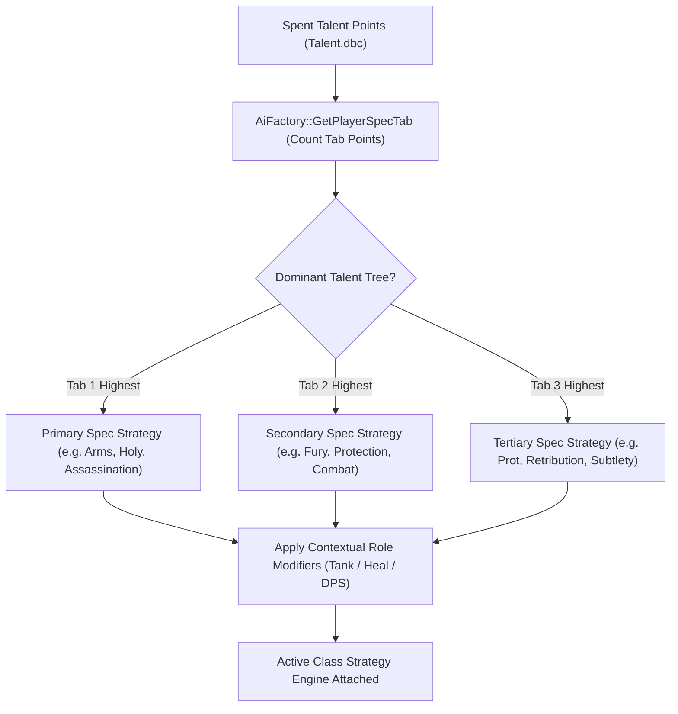

# Class AI & Roles Overview

TortoiseBots implements combat and utility AI for all nine Vanilla classes (Warrior through Druid). Bots detect their active talent spec dynamically, execute class-appropriate rotations, and support Turtle WoW 1.18.1 custom spells and talents.

## Supported Roles & Classes

| Class | Tank | Healer | Melee DPS | Ranged DPS | Crowd Control (CC) | Interrupts |
| :--- | :---: | :---: | :---: | :---: | :--- | :--- |
| **[Warrior](warrior.md)** | Prot | - | Arms, Fury | - | Intimidating Shout, Concussion Blow | Shield Bash, Pummel |
| **[Paladin](paladin.md)** | Prot | Holy | Retribution | - | Hammer of Justice, Repentance | Hammer of Justice, Repentance |
| **[Hunter](hunter.md)** | - | - | Survival (ranged-first hybrid) | BM, MM | Freezing Trap, Scare Beast | None (Scatter Shot snares) |
| **[Rogue](rogue.md)** | - | - | All Specs | - | Sap, Blind, Gouge | Kick |
| **[Priest](priest.md)** | - | Holy, Disc | - | Shadow | Shackle Undead, Psychic Scream, Chastise | Silence (Shadow) |
| **[Shaman](shaman.md)** | - | Resto | Enhancement | Elemental | None | Earth Shock |
| **[Mage](mage.md)** | - | - | - | All Specs | Polymorph | Counterspell |
| **[Warlock](warlock.md)** | - | - | - | All Specs | Fear, Banish | Spell Lock (Felhunter) |
| **[Druid](druid.md)** | Bear | Resto | Cat | Balance | Entangling Roots, Hibernate | Bash |

---

## Spec Detection & Strategy Selection

The bot determines its combat strategy dynamically by inspecting spent talent points:

- **Dominant Talent Tree:** The bot tallies spent talent points across the three class tabs. Whichever tree has the highest allocation activates that combat strategy.
- **Hybrid Support:** Hybrid classes adapt forms and stances based on context and assigned group roles.
- **Battlegrounds:** Healing specs retain healing priorities in battlegrounds, layering battleground objectives and PvP strategies on top.
- **Dynamic Role Assignment:** In parties, players can set bot roles to adjust aggro generation, healing urgency, and positioning.

Players can use [`.bot role <Name|self>`](../play/commands/roster-and-hiring.md#bot-role) to override runtime role inference. Without an override, role detection uses party composition, stance or form, and tanking equipment. If another tank already occupies the role, temporary stance or form changes do not promote a second tank.

---

## Shared Bot Behaviors

| Subsystem | Trigger Condition | Bot Action / Behavior | Configuration / Control |
| :--- | :--- | :--- | :--- |
| **Resting & Recovery** | Out-of-combat health or mana below recovery thresholds. | Sits down and consumes food and drink simultaneously. | See [Combat settings](../server/settings/combat.md). |
| **Buffs & Imbues** | Buff missing on self or party member. | Recasts class buffs, seals, auras, and weapon poisons. | Automatic out-of-combat maintenance. |
| **Targeting & Assist** | Tank or party leader engages hostile enemies. | Assists leader focus target and respects crowd control marks. | See [Focus skull](../play/commands/party-actions.md#bot-action-focus-skull). |
| **Finishing Runners** | Enemy mob flees below 30% health. | Ranged DPS finish within spell range; eligible melee close distance. | See detailed runner policy below. |
| **Threat Back-Off** | AoE threat at 50% of tank's threat, single-target threat at 80%. | Pauses high-threat single-target or AoE spells. | Controlled by `threat` strategy. |
| **Healer Off-DPS** | Party stable (no member below 90%) and mana >70–85% (95% in raids). | Contributes offensive spells and debuffs. | Controlled by `offdps` strategy. |
| **Spell Downranking** | Friendly target wounded but not in critical danger. | Casts lower-rank heals matching missing health. | Automatic triage optimization. |
| **Healer Positioning** | Party member out of heal range or line of sight. | Closes distance toward the tank or injured party member. | Automatic positioning routine. |
| **Looting & Gathering** | Corpse or nearby gathering node available. | Approaches corpse, loots quest items, and rolls on items. | See [Party actions](../play/commands/party-actions.md). |

Runner finishing, threat back-off, off-DPS, downranking, and healer positioning details

### Finishing Runners
When an enemy mob flees below 30% health (either flee state or flee-for-assistance):
- Ranged DPS finish the target within spell range.
- Warriors finish the runner if *Intercept* is available (in combat, Berserker Stance, rage available, off cooldown) within 25 yards.
- Other melee only attack runners already in melee reach.
- During `stay` holds, melee bots hold their position while ranged bots shoot within spell range.
- Healers and tanks do not chase runners.
- The active runner is never dropped for a fresh mob, and crowd-controlled targets are never chased.
- **Chases stop at ledges** (owner decision 2026-10-23): a running enemy more than 6 yards below a bot's floor, or running to a point more than 6 yards below it, is let go by every bot, the tank included, whatever picked it (the tank's victim, a raid mark, an explicit order); the bot stays on its floor. It stays let go for up to 30 seconds while it is still down there, and is a target again once it comes back up.

### Party Threat Back-Off
In groups with the `threat` strategy active, damage dealers (including Druids, Hunters, Mages, Shamans, and Warlocks) monitor relative threat against the tank. When AoE threat reaches 50% of the tank's, or single-target threat reaches 80% (high threat), they pause high-threat single-target nukes or area-of-effect spells (*Volley*, *Multi-Shot*, *Blizzard*, *Flamestrike*, *Rain of Fire*, *Chain Lightning*, *Earthquake*) until threat stabilizes.

### Healer Off-DPS (`offdps`)
When the `offdps` strategy is enabled, healing bots contribute damage spells only when the group is safe:
- No member below 90%.
- The healer's own mana exceeds 85% in hard fights, or 70% in even or easy fights.
- Casting immediately yields to incoming damage when an ally needs healing.

### Spell Downranking
Healing bots automatically select the lowest spell rank that covers the target's missing health to conserve mana. Full spell ranks are enforced whenever a target falls into critical health (at or below 20% health).

### Healer Positioning
When a party member is out of heal range or line of sight:
- The healer moves toward that member. The default follow anchor is the tank when no member is injured.
- If another living healer already has that member in range and sight, the healer does not path to them unless the member is at or below critical health.
- Silenced, pacified, crowd-controlled, or out-of-mana healers do not satisfy the coverage check.
- Out of combat, healers only path to members below 90% health.

