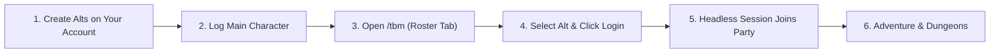

# Getting Started with TortoiseBots

TortoiseBots turns characters on your own account into intelligent companion bots to explore the open world, level together, and run 5-player dungeons. This guide walks you through setting up the companion addon, spawning your first bots, and leading a balanced party into the field.

TortoiseBots is designed for a player who plays solo on their realm. The world is populated by autonomous bots who level, travel, and trade, while you can bring your own characters or hire temporary mercenaries to tackle group content.

## The Kinds of Bots

TortoiseBots features three distinct categories of bots in the game world:

| Kind | What it is | Persistence |
| :--- | :--- | :--- |
| **Pool bots** | Random characters levelling and wandering the open world. | Permanent characters that live in the world database. |
| **Own alts** | Characters you created on your own player account. | Permanent characters fully owned and customized by you. |
| **Hired companions** | Mercenary companions hired for a play session. | Temporary characters deleted after dismissal or logout grace. |

<details>
<summary>How bot types differ in gameplay</summary>

Pool bots represent the living realm: they start at level 1 in starter zones, grind, quest, run dungeons via queue autofill, and progress naturally. They never join your private roster directly unless hired or claimed.

Your own alts are secondary characters on your account. When spawned with `.bot add`, the server starts a headless session for that character and places them directly into your group. You can swap gear, train spells, set talents, and log into them directly as a human player at any time.

Hired companions are generated on demand at capital recruiters or mercenary inns to match your character level. When dismissed or when you leave the party, they are cleanly cleaned up and never pollute the organic world pool.

</details>

## Quick Setup Workflow



### Prerequisites

1. Create the characters you want to use as bots on your account at the character select screen.
2. Download and install the [TortoiseBotsManager](commands/addon.md) addon into your client's `Interface/AddOns/` directory.
3. Log into your main character in the game world.

## Spawning Your Bots

You can manage your bots using the in-game addon interface or through native chat commands.

### In-Game Addon (`/tbm`)

1. Type `/tbm` in chat to open the management panel. See [TortoiseBotsManager Addon](commands/addon.md) for full controls.
2. Open the **Roster** tab.
3. Select an alt character from the list and click **Login** or **Invite**.
4. The alt enters the world as a headless session and joins your party.

### Command-Line Shortcuts

You can also control bot logins directly using chat commands:

```text
.bot add <CharacterName>
.bot summon <CharacterName>
.bot remove <CharacterName>
```

See [Roster and Hiring Commands](commands/roster-and-hiring.md) for full command syntax.

> [!NOTE]
> **Human Reclaim:** If you want to play an alt character yourself while it is currently running as a bot, simply log into it from the character select screen. The server automatically disconnects the bot session and logs your human client in normally.

### Progression and Training Tips

- **Level Synchronization:** When [`AiPlayerbot.SyncAltLevelToMaster`](../server/settings/party.md#aiplayerbotsyncaltleveltomaster) is enabled, owned bots in your group gain one level per update until they match your leader level.
- **Spell Training:** Escort your bots to class trainers in major cities and whisper `trainer` to each bot (or use `.bot command <Name> trainer`). The bot automatically learns all available spell ranks and class abilities in a single pass. See [Whisper Commands](commands/whispers.md#trainer).
- **Hiring Mercenaries:** If you lack alts of a specific class, visit a recruiter NPC in any capital city and hire a temporary companion at your level. See [Roster and Hiring Commands](commands/roster-and-hiring.md#bot-hire) and [Hiring Settings](../server/settings/hiring.md).

## Building a Balanced 5-Man Party

A standard dungeon group consists of one tank, one healer, one melee DPS, and two ranged DPS.

| Role | Recommended Classes & Specs | Primary Responsibilities | Tactical Strengths |
| :--- | :--- | :--- | :--- |
| **Tank** (1) | Protection Warrior, Feral Bear Druid, Protection Paladin | Holds primary threat and positions packs. | High mitigation, taunt mechanics, and melee interrupts. |
| **Healer** (1) | Holy Priest, Restoration Shaman, Holy Paladin, Resto Druid | Maintains party health and dispels debuffs. | Triage healing, dispel coverage, and party recovery. |
| **Melee DPS** (1) | Combat Rogue, Fury Warrior, Feral Cat Druid | Focuses single-target burst and kicks spells. | Physical burst, secondary interrupts, and stealth Sap. |
| **Ranged DPS** (2) | Frost Mage, Marksmanship Hunter, Affliction Warlock | Deals ranged burst and provides crowd control. | Polymorph, Freezing Trap, Banish, and food summons. |

## Basic Controls in the Field

Use these essential actions to direct your bots during dungeon runs and combat:

| Intent / Action | Addon Button | Chat Command | Bot Behavior |
| :--- | :--- | :--- | :--- |
| **Regroup / Unstuck** | **Summon** | [`.bot summon <Name>`](commands/roster-and-hiring.md#bot-summon) | Teleports an out-of-combat bot directly to your coordinates. |
| **Focus Target** | **Focus Skull** | [`.bot action focus skull`](commands/party-actions.md#bot-action-focus-skull) | Orders all DPS bots to prioritize the Skull-marked target. |
| **Pullback Maneuver** | **Pullback** | [`.bot action pullback`](commands/party-actions.md#bot-action-pullback) | Orders the tank to pull from range and retreat behind a corner. |
| **Hold Position** | **Stay** | [`.bot action stay`](commands/party-actions.md#bot-action-stay) | Halts bot movement and pauses casting to prevent adds. |
| **Resume Follow** | **Follow** | [`.bot action follow`](commands/party-actions.md#bot-action-follow) | Resumes normal follow formation behind the party leader. |
| **Crowd Control** | **CC Mark** | [`.bot action cc <mark>`](commands/party-actions.md#bot-action-cc) | Assigns a bot with matching CC spells to disable a marked target. |
| **Disable AoE** | **AoE Off** | [`.bot action aoe off`](commands/party-actions.md#bot-action-aoe) | Disables area spells to protect active crowd control. |

For detailed dungeon mechanics, LoS corner pulls, and raid strategies, read the [Dungeon & Raid Tactics Guide](dungeons-and-raids.md). For complete command syntax, see [Party Action Commands](commands/party-actions.md).
