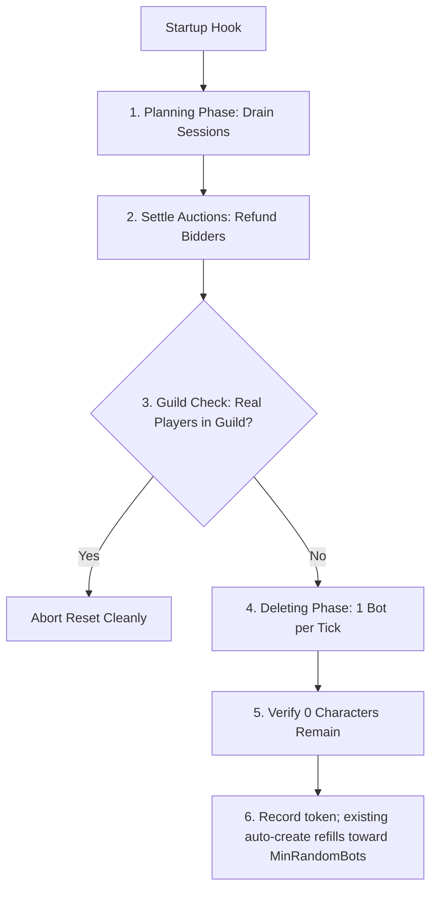

# Managing & Resetting the Bot Pool

TortoiseBots maintains an autonomous population of random pool bots that level, wander, run dungeons, and trade across the realm. This document explains how the managed account registry identifies pool bots, how administrators adopt existing accounts, and how to safely rebuild the bot pool without risking player characters.

For configuration settings governing pool size and creation limits, see [World population settings](settings/world-population.md).

## The Managed Pool Registry

To guarantee player safety, TortoiseBots uses a strict account registry to identify pool accounts. An account is treated as part of the managed pool **only** if it has an explicit registry record.

- **Account Prefix Separation:** The [`AiPlayerbot.RandomBotAccountPrefix`](settings/world-population.md#aiplayerbotrandombotaccountprefix) setting is used to name newly created bot accounts and to scan legacy accounts for adoption. A matching prefix alone never authorizes character deletion.
- **Pre-Execution Validation:** Every registered pool account is validated against the login database (both account ID and username) before any destructive action can run.
- **Player Account Isolation:** Personal player accounts and owned alts are never registered in the pool registry. Even if a player account shares a name similar to a bot prefix, it cannot be modified or deleted by pool maintenance.

## Adopting Legacy Bot Accounts

If you are upgrading an older server installation where bot accounts were created by earlier systems, those accounts must be explicitly enrolled into the registry before they can be managed or reset. At startup, the server logs an error warning if accounts match the random-bot prefix but are not registered in the managed pool registry, noting they are ignored by the pool until enrolled via `bot pool adopt preview`.

Adoption is available **only at the server console**:

1. At the server console, preview candidate accounts using [`bot pool adopt preview`](admin-commands.md#bot-pool-adopt-preview).
2. Review the list of accounts found matching the prefix. The command generates a unique challenge token.
3. Confirm adoption using the exact challenge token via [`bot pool adopt confirm <challenge>`](admin-commands.md#bot-pool-adopt-confirm).
4. Verify enrollment by checking pool status via [`bot pool status`](admin-commands.md#bot-pool-status).

Adoption only registers accounts in the registry table. It never deletes, renames, or modifies any characters or accounts. See [Admin Commands](admin-commands.md#bot-pool-status).

## Resetting the Managed Bot Pool

Changes to fresh-character level seeding, starter gear rules, class talent specs, or profession seeding only apply to newly generated bots. To completely rebuild the world pool—keeping the existing login accounts while regenerating fresh characters—you configure a one-shot generation reset.

The pool reset runs **only during initial world startup** on the world thread:
- The command `.reload config` will never start a pool reset.
- No live in-game reset command exists. A running server world is never mutated during active play.

### Reset Modes

Configure [`AiPlayerbot.RandomBotPoolReset`](settings/world-population.md#aiplayerbotrandombotpoolreset) in `aiplayerbot.conf`:

| Setting Value | Behavior |
| :--- | :--- |
| `off` | Never reset automatically. Default and recommended production setting. |
| `once:<token>` | Resets on next startup only if `<token>` differs from the last completed token. |
| `always` | Resets on every server startup. Development only; wipes progression on restart. |
| *(invalid)* | Any other string logs an error and aborts the reset safely. |

### Step-by-Step Reset Workflow

Follow these steps to rebuild the bot pool on an active realm:

1. **Back up the character database:** Always create a database backup before performing maintenance.
2. **Start the server with reset disabled:** Ensure `AiPlayerbot.RandomBotPoolReset = off` in `aiplayerbot.conf`.
3. **Check current pool status:** Run [`bot pool status`](admin-commands.md#bot-pool-status) (at the console or GM in-game) to view active accounts.
4. **Adopt legacy accounts if needed:** If upgrading an older database, run [`bot pool adopt preview`](admin-commands.md#bot-pool-adopt-preview) followed by `bot pool adopt confirm <challenge>`.
5. **Confirm registered accounts:** Run [`bot pool status`](admin-commands.md#bot-pool-status) to verify managed account counts.
6. **Stop the server cleanly:** Shut down `mangosd` normally.
7. **Set a new generation token:** Edit `aiplayerbot.conf`:
   ```ini
   AiPlayerbot.RandomBotPoolReset = once:fresh-build-01
   AiPlayerbot.RandomBotAutoCreate = 1
   ```
8. **Start the server:** Monitor `Server.log` during startup for lines like:
   ```text
   TortoiseBots: random pool generation 'fresh-build-01'; reset scheduled...
   TortoiseBots: random pool reset progress: ...
   TortoiseBots: random pool reset verified: 0 characters remain...
   TortoiseBots: random pool generation 'fresh-build-01' applied; pool rebuild starts now
   ```
9. **Verify clean rebuild:** Run [`bot pool status`](admin-commands.md#bot-pool-status). New characters will begin generating up to [`MinRandomBots`](settings/world-population.md#aiplayerbotminrandombots--maxrandombots).
10. **Leave the token in place:** The token can remain in the configuration file; since it matches the completed generation, it will not run again on future restarts.

### What a Reset Intentionally Deletes

When a reset executes, the following pool bot data is permanently removed:
- Character levels, equipment, inventory, bank storage, quests, and profession progression for pool bots.
- Characters and module rows for pool accounts (pinned bots resolve by name and are re-created by auto-create).
- Hired mercenaries riding pool accounts.
- Guilds composed exclusively of pool bots.
- Active auction listings posted by pool bots. Active bidders receive full mail refunds prior to listing deletion (hardcore characters excepted).
- An empty managed set is a verified no-op: the generation is still recorded, so a token cannot silently wipe a pool that auto-create builds afterwards.

Login accounts themselves are **never deleted**. The server retains the registered pool accounts and generates fresh level 1 characters on them.

### Safety Guarantees & Multi-Phase Execution

The startup reset engine operates in distinct safety phases to prevent data loss or server corruption:



<details>
<summary>Detailed safety invariants and auction settlement</summary>

- **Session Draining:** Pool bot headless sessions are drained and disconnected before deletion starts. If any bot session fails to disconnect within a bounded timeout, the reset fails immediately without deleting characters.
- **Human Session Protection:** If a player logs into a pool character, the reset detects the human network session and aborts before any further deletion (a preflight abort happens before anything is deleted).
- **Pre-Settlement Auction Refunds:** In the auction phase, every active listing posted by a pool bot is inspected through core auction managers. Active bidders are mailed full refunds before any characters are removed. Hardcore bidders follow core rules and are not refunded. If any bidder cannot be resolved, the reset stops immediately.
- **Guild Member Protection:** If a pool bot leads a guild that contains even one human player, the reset aborts and logs the guild name and leader to prevent disbanding player guilds.
- **Atomic Progress Recording:** The new token is committed to `tortoise_bots_pool_state` only after all managed characters are deleted and verified. If the server terminates mid-reset, the uncompleted reset resumes on the next startup.
- **Module Maintenance Lock:** While a reset is running, if a reset encounters an error, or if the registry cannot be validated, the pool stays unavailable: pool hiring, auto-creation, autologin, and battleground bot selection remain locked until resolved.

</details>
