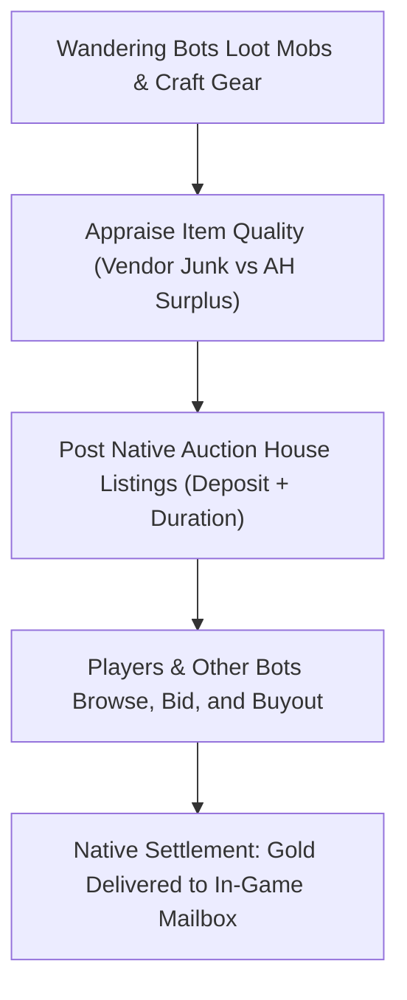

# Economy & auction house

This page explains how bots generate gold, repair their equipment, sell surplus items to vendors, and participate in the server economy. Auction house and trading settings are configured in `aiplayerbot.conf`; see [Economy & auction house settings](../server/settings/economy.md).

## Economic philosophy

TortoiseBots is built around a realistic player economy rather than artificial handouts:

- **Looted and crafted goods:** Items listed on the Auction House originate from creature drops, quest rewards, and bot crafting.
- **No gold injection:** Bots earn gold exclusively through open-world questing, monster grinding, and vendor liquidation. If a bot cannot afford class trainer abilities, it prioritizes selling accumulated loot rather than receiving free currency.
- **Earned equipment:** Bots do not receive free gear sets on level-up. All equipment progression is earned through world loot, quest rewards, professions, or vendor purchases.
- **Practical exceptions:** To keep gameplay reliable, bots receive unlimited class reagents and ammunition via the item cheat, and critical tools (such as profession implements and thieves' tools) are seeded automatically. Server administrators may optionally enable uncommon and rare drop rate multipliers to compensate for lower bot kill volume.

## Vendor liquidation & repairs

Bots manage their personal finances by balancing earnings against repairs, training, and travel expenses:

| Activity | Behavior | Control |
| :--- | :--- | :--- |
| **Vendor sales** | Bots sell grey junk and surplus gear in batches to minimize unnecessary travel. | [`AiPlayerbot.VendorBatchMinCount`](../server/settings/economy.md#aiplayerbotvendorbatchmincount--vendorbatchminbagspace) |
| **Low-level vendor trips** | Fresh bots (below level 5) sell early items to nearby camp vendors within safe range. | [`AiPlayerbot.LowLevelVendorMaxDistance`](../server/settings/economy.md#aiplayerbotlowlevelvendormaxdistance) |
| **Spell money prioritization** | Bots short on gold for trainable spell ranks liquidate bags to fund training. | Automatic AI logic |
| **Equipment repairs** | Bots visit blacksmiths to repair equipment when durability drops into yellow or red thresholds. | Automatic AI logic |
| **Inventory cleanup** | When bags fill and vendors are unreachable, bots destroy low-value items in strict order. | Automatic AI logic |

Vendor trip batching & low-level sales in detail

To prevent bots from walking to town after every single kill, vendor trips are batched based on item volume and bag capacity:
- **Standard batching (level 5+):** Governed by [`AiPlayerbot.VendorBatchMinCount`](../server/settings/economy.md#aiplayerbotvendorbatchmincount--vendorbatchminbagspace) (default 8 items) and `VendorBatchMinBagSpace` (default 60% bag fullness). A bot initiates a vendor journey only when its vendor-usable stock meets these thresholds or provides sufficient coin to train an available class spell rank.
- **Beginner batching (levels 1–4):** Governed by [`AiPlayerbot.LowLevelVendorBatchMinCount`](../server/settings/economy.md#aiplayerbotlowlevelvendorbatchmincount--lowlevelvendorbatchminbagspace) (default 3 items) and `LowLevelVendorBatchMinBagSpace` (default 25% bag fullness). This allows new characters to liquidate early pelts and broken weapons without waiting for full bags.
- **Camp distance limits:** Masterless bots below level 5 are restricted to nearby camp vendors within [`AiPlayerbot.LowLevelVendorMaxDistance`](../server/settings/economy.md#aiplayerbotlowlevelvendormaxdistance) (default 600 yards). If a vendor visit produces no valid sales, the errand is paused for ten minutes.

Protected inventory items & cleanup order in detail

Autonomous sell routines evaluate inventory items carefully:
- **Protected goods:** Bots never sell food, drink, bandages, potions, class spell reagents, ammunition for equipped ranged weapons, or active quest items, regardless of stack size.
- **Liquidated stock:** Only grey trash items, unneeded profession materials, and surplus equipment scoring lower than equipped gear are sold.
- **Smart destruction order:** When inventory reaches 90% capacity and no vendor can be reached, bots destroy items in strict priority order: completely unusable junk first, abandoned quest items second (only when coin is required and sales are impossible), cheapest grey items third, profession materials fourth, and consumables last.

Mount savings & trainer reserves in detail

Bots budget gold carefully before spending on optional upgrades:
- **Trainer reserve:** When evaluating travel fares or vendor gear purchases, bots protect a reserve fund dedicated to upcoming class ability ranks.
- **Mount budgeting:** Gold accumulation for mounts is protected by [`AiPlayerbot.MountBreakEvenFactor`](../server/settings/economy.md#aiplayerbotmountbreakevenfactor) (default 1.5). Bots accumulate a surplus above base mount training costs before purchasing luxury items.

## Living Auction House (`AhMarketService`)

TortoiseBots provides an active, simulated player economy that maintains steady Auction House supply and demand:

- **Bot sellers:** Bots list surplus profession materials (cloth, herbs, ore, leather), green and blue Bind-on-Equip (BoE) gear, and crafted consumables at competitive market prices.
- **Bot buyers:** When bots accumulate surplus gold, they scan the Auction House for equipment upgrades suited to their class and talent specialization, placing bids or buying out items.
- **Native mail settlement:** All bot auction transactions use core mail systems. When a bot purchases an auction listed by a human player, gold is delivered directly to the player's in-game mailbox.
- **Settings:** The core market is toggled by [`AiPlayerbot.AhMarketEnabled`](../server/settings/economy.md#aiplayerbotahmarketenabled) (default 0). Optional synthetic listings and buyers are controlled by [`AiPlayerbot.AhMarketSyntheticSupply`](../server/settings/economy.md#aiplayerbotahmarketsyntheticsupply) and [`AiPlayerbot.AhMarketBuyer`](../server/settings/economy.md#aiplayerbotahmarketbuyer).

Organic buyer mechanics in detail

The organic Auction House buyer operates without artificial teleportation:
- Only masterless pool bots of level 10 or higher with at least 5 gold in unreserved purse are selected.
- Eligible bots travel on foot or by flight path to a capital city auction house during the hourly RPG window.
- Upon arrival, the bot evaluates current listings matching its class and spec, placing bids using native funds.
- Rotating background scans examine eight bots per listing pass to prevent server latency spikes. Grouped bots, dungeon parties, and battleground participants are excluded from market errands.

## Market administration & drop tuning

Administrators can monitor and tune economic activity:

- **Administration commands:** Server operators can inspect market volume, reload custom price tables, trigger market rebuilds, and blacklist specific items using the [`.bot ah`](../server/admin-commands.md#autonomous-auction-house-administration-bot-ah--ahbot) and `.ahbot` commands.
- **Drop rate multipliers:** To adjust bot progression without inflating player drop rates, administrators can scale uncommon and rare item drop rates for pool bots using [`AiPlayerbot.BotLootRateUncommon`](../server/settings/economy.md#aiplayerbotbotlootrateuncommon--botlootraterare) and `BotLootRateRare` (defaults `1.0`). Quest items, starter drops, and player characters are excluded from drop boosts.
