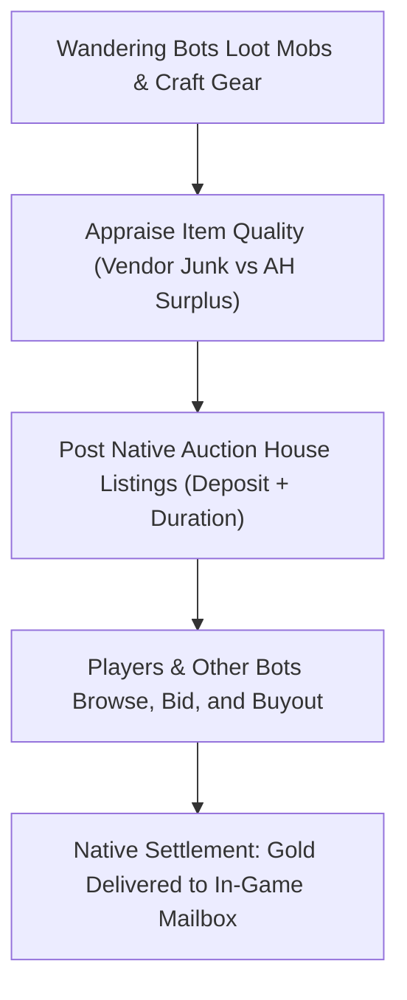

# Economy & auction house

This page explains how bots generate gold, repair their equipment, sell surplus items to vendors, and participate in the server economy. Auction house and trading settings are configured in `aiplayerbot.conf`; see [Economy & auction house settings](../server/settings/economy.md).

## Economic philosophy

TortoiseBots is built around a realistic player economy rather than artificial handouts:

- **Looted and crafted goods:** Items listed on the Auction House originate from creature drops, quest rewards, and bot crafting.
- **Earned gold:** Bots receive a level-scaled coin grant on first seed only (the seeder skips any bot already holding coin, so re-seeds never refill), then earn the rest from quests, kills, and vendor sales; bots short for trainer ranks sell loot first (see [vendor trip batching](#vendor-liquidation--repairs)).
- **Equipment progression:** Bots receive starter kit gear scaled to level on creation and earn subsequent equipment through world drops, quest rewards, professions, or vendor purchases, gated by configured seed tiers ([`AiPlayerbot.RandomGearMaxSourceTier`](../server/settings/world-population.md#aiplayerbotrandomgearmaxsourcetier)).
- **Practical exceptions:** To keep gameplay reliable, class reagents and ammunition are topped up by the item cheat within bounded stacks (repeat vendor purchases stop past one held stack; the per-tick refill tops the equipped ammo stack), and profession implements are seeded with the starter kit ([Field kits](living-world.md#field-kits--equipment-upkeep)). Server administrators may optionally enable uncommon and rare drop rate multipliers to compensate for lower bot kill volume.

## Vendor liquidation & repairs

Bots manage their personal finances by balancing earnings against repairs, training, and travel expenses:

| Activity | Behavior | Control |
| :--- | :--- | :--- |
| **Vendor sales** | Bots sell grey junk and surplus gear in batches to minimize unnecessary travel. | [`AiPlayerbot.VendorBatchMinCount`](../server/settings/economy.md#aiplayerbotvendorbatchmincount--vendorbatchminbagspace) |
| **Low-level vendor trips** | Fresh bots (below level 5) sell early items to nearby camp vendors within safe range. | [`AiPlayerbot.LowLevelVendorMaxDistance`](../server/settings/economy.md#aiplayerbotlowlevelvendormaxdistance) |
| **Spell money prioritization** | Bots short on gold for trainable spell ranks liquidate bags to fund training. | Automatic AI logic |
| **Equipment repairs** | Bots visit blacksmiths to repair when overall durability drops below 30% (or any item below 10%). | Automatic AI logic |
| **Inventory cleanup** | When bags fill and vendors are unreachable, bots destroy low-value items in strict order. | Automatic AI logic |

Vendor trip batching & low-level sales in detail

To prevent bots from walking to town after every single kill, vendor trips are batched based on item volume and bag capacity:
- **Standard batching (level 5+):** Governed by [`AiPlayerbot.VendorBatchMinCount`](../server/settings/economy.md#aiplayerbotvendorbatchmincount--vendorbatchminbagspace) and `VendorBatchMinBagSpace`. A bot initiates a vendor journey only when its vendor-usable stock (at least one item a vendor actually buys) meets these thresholds or provides sufficient coin to train an available class spell rank.
- **Beginner batching (levels 1–4):** Governed by [`AiPlayerbot.LowLevelVendorBatchMinCount`](../server/settings/economy.md#aiplayerbotlowlevelvendorbatchmincount--lowlevelvendorbatchminbagspace) and `LowLevelVendorBatchMinBagSpace`. This allows new characters to liquidate early pelts and broken weapons without waiting for full bags.
- Bag-pressure line: with stock a vendor buys, bags over 80% full also trigger the vendor errand; empty food or drink bags trigger it only when the bot can pay to restock.
- **Camp distance limits:** Masterless bots below level 5 are restricted to nearby camp vendors within [`AiPlayerbot.LowLevelVendorMaxDistance`](../server/settings/economy.md#aiplayerbotlowlevelvendormaxdistance). If a vendor visit produces no valid sales, the errand is parked for ten minutes.

Protected inventory items & cleanup order in detail

Autonomous sell routines evaluate inventory items carefully:
- **Protected goods:** The usage classifier, not a sell filter, protects rations: food and drink the bot eats, bandages, potions, class spell reagents, and ammunition matching the equipped ranged weapon are never classified as vendor trash, so autonomous sell routines never sell them. Quest-class items are kept while a quest needs them and enter the strict cleanup order only when abandoned.
- **Liquidated stock:** Only grey trash items, unneeded profession materials, and surplus equipment scoring lower than equipped gear are sold (soulbound Bind-on-Equip gear already worn cannot be listed; repair cost above the auction profit keeps an item at the vendor).
- **Smart destruction order:** When bags reach 90% capacity and no vendor can be reached, bots destroy items in strict priority order: genuinely useless items first, then abandoned quest items only when coin is required for a spell rank and sales are impossible (bots with a real-player master or in a real guild destroy grey trash only), then cheapest grey trash, then profession materials and consumables last.

Mount savings & trainer reserves in detail

Bots budget gold carefully before spending on optional upgrades:
- **Trainer reserve:** When evaluating travel fares or vendor gear purchases, bots protect a reserve fund dedicated to upcoming class ability ranks (only free money above the spell purse is spendable).
- **Mount travel threshold:** Mount usage is gated by [`AiPlayerbot.MountBreakEvenFactor`](../server/settings/economy.md#aiplayerbotmountbreakevenfactor): only trips longer than the cast-time break-even distance trigger mounting (about 350 yd on the 9%-speed turtle, 50 yd at 60%, 30 yd at 100% with the default `1.5`); `0` removes the threshold.

## Living Auction House

TortoiseBots provides an active, simulated player economy that maintains steady Auction House supply and demand. The market service is enabled by [`AiPlayerbot.AhMarketEnabled`](../server/settings/economy.md#aiplayerbotahmarketenabled) and requires logged-in pool bots ([`AiPlayerbot.RandomBotAutologin`](../server/settings/world-population.md#aiplayerbotrandombotautologin)):

- **Bot sellers:** Bots list surplus items the usage classifier marks for auction (gear where the auction profit beats the vendor price after deposit and repair costs, profession materials, and crafted goods) at market-model prices with a native deposit.
- **Bot buyers:** Bots holding spendable gold scan the Auction House for equipment upgrades suited to their class and talent specialization, placing bids or buying out listings that beat equipped gear by the configured value threshold.
- **Native mail settlement:** All bot auction transactions use core mail systems. When a bot purchases an auction listed by a human player, gold is delivered directly to the player's in-game mailbox.
- **Settings:** The core market is toggled by [`AiPlayerbot.AhMarketEnabled`](../server/settings/economy.md#aiplayerbotahmarketenabled). Optional synthetic listings and buyers are controlled by [`AiPlayerbot.AhMarketSyntheticSupply`](../server/settings/economy.md#aiplayerbotahmarketsyntheticsupply) and [`AiPlayerbot.AhMarketBuyer`](../server/settings/economy.md#aiplayerbotahmarketbuyer). Chance, value, spend, quality, level, variance, bid, and duration tuning live in [Economy settings](../server/settings/economy.md).

Organic buyer mechanics in detail

The organic Auction House buyer operates without artificial teleportation:
- Only masterless pool bots (never hires or alts) of level 10 or higher with spendable purse above the trainer reserve qualify: free money for general spending must cover at least 5 gold.
- Eligible bots walk or fly to the nearest auction house on the bot's own map (same-map house required; cross-map listings are unroutable, so no trip opens). One buyer trip per bot per 10 minutes, no teleporting.
- Upon arrival, the bot evaluates current listings matching its class and spec through the `rpg ah buy` action, placing bids using native funds.
- Rotating scans probe eight bots per listing pass to spread load across the pool. Grouped bots, LFT-queued/in-offer bots, and battleground/instance/dungeon bots are excluded from market errands.

## Market administration & drop tuning

Administrators can monitor and tune economic activity:

- **Administration commands:** Server operators can inspect market volume, reload custom price tables, trigger market rebuilds, and inspect or override item pricing using the [`.bot ah`](../server/admin-commands.md#autonomous-auction-house-administration-bot-ah--ahbot) and `.ahbot` commands (including `.bot ah item <id>` status, `reset`, `<value> [chance] [min] [max]` overrides, and `0 0` blacklisting).
- **Drop rate multipliers:** To adjust bot progression without inflating player drop rates, administrators can scale uncommon and rare item drop rates for pool bots using [`AiPlayerbot.BotLootRateUncommon`](../server/settings/economy.md#aiplayerbotbotlootrateuncommon--botlootraterare) and `BotLootRateRare` (default `1.0` = off; the extra roll runs once per kill on the creature's own loot template at `(multiplier - 1) x` each entry's chance). Quest-class or quest-starting items and unique items already held at `max_count` are never boosted; player characters, hired/alt bots, and group loot (non-personal or unowned corpses) keep server rates.
