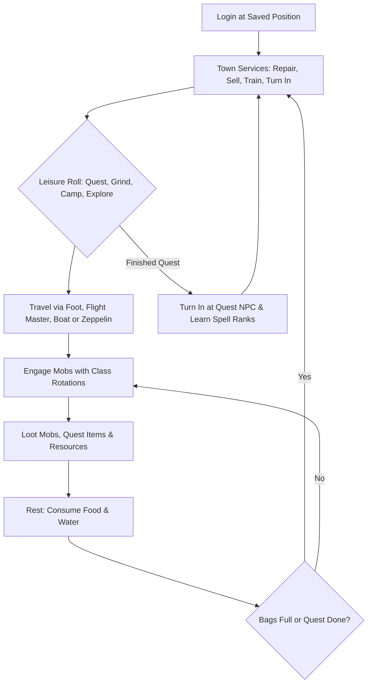

# Living world & autonomous bots

This page explains how autonomous bots inhabit the realm, progress through levels, explore zones, and handle equipment and sustenance. Settings controlling pool size, leveling, and wandering are configured in `aiplayerbot.conf`; see [World population & immersion settings](../server/settings/world-population.md).

## Overview

TortoiseBots populates the game world with autonomous characters on managed pool accounts. These bots travel through zones, complete quests, grind hostile creatures, gather crafting materials, trade on the Auction House, and form guilds. The world feels active and populated without requiring human players to fill every zone.

Managed pool accounts are tracked in the character-database registry ([The Managed Pool Registry](../server/bot-pool.md#the-managed-pool-registry)).

Hired mercenary companions are temporary characters created through the hire flow. When dismissed, released, or expired after player logout, the character is permanently deleted and never returns to the roaming pool. The freed pool capacity is refilled by auto-create toward the configured bot counts ([`AiPlayerbot.MinRandomBots`](../server/settings/world-population.md#aiplayerbotminrandombots--maxrandombots)). Roaming alt-bots, by contrast, stay active in the world ([Alt-bots](../play/commands/roster-and-hiring.md#alt-bots-autonomous-alts)).

## Autonomous bot lifecycle

Autonomous bots follow a continuous decision loop from login to rest and maintenance:

Bots resume at their saved position upon logging in and use nearby town services for repairs, selling, training, and quest turn-ins. Otherwise, the bot rolls a leisure purpose, travels by foot, flight, boat, or zeppelin to its destination, engages targets, loots corpses, and rests before continuing or returning to town services. Teleports are a last resort for stuck travel, ghost recovery, and level-appropriate scatter of newly seeded bots rather than routine movement.

## Open-world activities

The table below summarizes autonomous activities in the open world:

| Activity | How it works |
| :--- | :--- |
| **Zone travel** | Bots travel on foot, take flight paths, ride zeppelins and boats, and use hearthstones. |
| **Grinding & combat** | Bots engage level-appropriate mobs and execute class rotations. |
| **Grind-spot ladder** | Bots move to new camps and zones as they outgrow lower-level creatures. |
| **Beginner grinding** | Fresh bots (levels 1-4) hunt starter beasts and ignore no-XP critters. |
| **Questing** | Bots accept level-appropriate quests, complete objectives, and turn them in for rewards. |
| **Leisure mixer** | Pool bots pick leisure tasks from a weighted distribution of quests, grinding, and exploration. |
| **Quest-log upkeep** | Bots abandon obsolete or failed quests and prioritize turn-ins over grinding. |
| **Gathering** | Bots gather nearby herbs and mining nodes, and skin beasts they kill. |
| **Fishing** | Idle pool bots fish in nearby open water. |
| **Town services** | Bots visit nearby trainers, repair gear at blacksmiths, and sell vendor trash. |

Travel & flight paths in detail

Autonomous pool bots travel without routine teleporting. When a bot selects a distant destination, it plans a route using flight masters, zeppelins, boats, or roads.

Flight paths are selected from known taxi nodes to the node nearest the destination. The hop must be level-appropriate (the destination area can be at most five levels above the bot), and the bot must have enough gold to cover the flight fare above its class trainer savings reserve. The bot walks to the flight master, boards the taxi, and pays standard fare. Cross-zone travel such as leaving starting islands occurs naturally by air or boat rather than artificial movement. Teleports remain as a last resort for stuck travel, ghost recovery, and level-appropriate scatter of newly seeded bots.

A destination is only accepted when the walk there is survivable, not just when the destination itself fits: the route is checked at every waypoint and along the legs between them (every 64 yd, against the static town-guard index and the same area-level table the destination gates use), so a bot refuses a trip whose walk crosses a hostile-faction town or an area more than five levels above it. Boat, zeppelin, portal and taxi hops are exempt - the bot is a passenger, not on foot. The verdict is cached per bot and destination for five minutes.

Grinding & combat rules in detail

A bot picks grind targets within its sight distance, configured by [`AiPlayerbot.SightDistance`](../server/settings/combat.md#aiplayerbotsightdistance). Melee bots close into melee range, while ranged bots position at spell distance.

Autonomous bots never initiate combat against grey (zero-XP) creatures. If attacked by a grey creature, the bot defends itself, and ordered or quest kills remain permitted. If a bot cannot reach its selected target within 15 seconds due to terrain obstruction, the target is abandoned and blacklisted for five minutes. If a second give-up occurs within three minutes, the bot leaves the area and selects a different camp.

Grind-spot ladder (levels 1–60) in detail

Bots progress across a level ladder to avoid lingering in outgrown areas. Grind destinations are valid only when creatures sit between two levels below and one level above the bot (widening to two levels above starting at level 10).

When local creatures stop providing adequate experience, the current travel target expires. The bot then walks, takes a flight master, or boards a boat to the nearest camp matching its level band. Individual grind orders cap at one level above the bot below level 10 (four above from level 10). Camps occupied by too many active bots are skipped for quieter spots across the zone.

Beginner grinding (levels 1–4) in detail

Fresh bots in starting valleys (Valley of Trials, Camp Narache, Northshire, Coldridge, Shadowglen, Deathknell) target creatures in the grind level band, including coinless starter beasts like boars, scorpids, and plainstriders:
- Grind travel for levels 1–4 skips zone-average level gates, walking directly to nearby starter beast fields within the same zone and starter spawn leash.
- Owned and hired companions keep the copper-only destination prey rule during early grinding.
- True non-experience critters like rabbits are skipped, while wild critter-type beasts that yield experience remain valid targets. Below level 10, grind orders restrict targets to at most one level above the bot, preventing fresh characters from attempting difficult encounters.

Questing & quest-log maintenance in detail

Masterless pool bots pick up quests appropriate for their level. Below level 10, bots only accept quests rated up to three levels above themselves, and avoid cross-zone deliveries for quests rated above their own level.

Pool bots periodically clean their quest logs:
- Finished quests that cannot be rewarded are abandoned.
- Grey delivery quests whose required items are lost are dropped.
- Grey quests are ignored unless the reward provides an equipment upgrade.
- Unfinishable solo quests (such as elite, raid, or out-of-zone objectives) are abandoned when fewer than two log slots remain.
- If a bot makes no progress on a quest objective for five minutes, pursuit of that objective is parked for 30 minutes, allowing the bot to work on other tasks. The quest stays in the log and can still be turned in.
- A completed quest turn-in journey takes precedence over grinding, and the bot paths to the quest taker.

Leisure mixer in detail

Masterless pool bots select their next leisure journey from a weighted table:
- **Questing:** Weight 60 (requires open quest log slots and unparked quests).
- **Grinding:** Weight 15 (requires unparked grind objectives).
- **Camp hunting:** Weight 10 (available at level 5 and above).
- **Exploration:** Weight 5 (available when the exploration strategy is active).

If a chosen purpose becomes invalid, the bot re-rolls immediately rather than idling. Service errands (visiting vendors, trainers, mailboxes, or the Auction House) always bypass the leisure roll and take immediate priority.

Gathering & professions in detail

Bots gather resource nodes they encounter while roaming. Herb and ore nodes within sight and range are gathered, and skinnable beasts are skinned immediately after looting.

Starting at level 10, bots with Herbalism or Mining will travel directly to nearby resource nodes. If a bot reaches a resource spawn point and finds it depleted, that spawn point is remembered as empty for about one node respawn (15 minutes). Mining needs a mining pick and skinning needs a skinning knife in the bot's inventory; without the tool, gathering interactions fail.

Fishing in detail

Masterless pool bots carrying a fishing pole engage in fishing as a casual side activity. Fishing occurs only when the bot is completely idle—with no pending travel, no completed quests to turn in, no vendor or repair needs, and bags at or below 90% capacity.

Side-activity fishing targets visible fishing holes or nearby open shores; approaching hostile creatures within 30 yards or entering combat ends fishing immediately and restores the bot's weapon. Pool bots fish open water directly; the stored world fishing-location travel table is currently empty, so dedicated travel errands to fishing locations never produce a destination. Fishing travel respects the bot's Fishing skill and strips travel errands inside dungeons and raids.

Town life & service visits in detail

When idle in town, bots interact with nearby service NPCs within 50 yards before requesting travel errands. They turn in completed quests, accept available quests, train affordable new spell ranks, and vendor accumulated junk. Bots at 85%+ bag capacity sell immediately regardless of batch counters.

A vendor trip requires a valid reason: items that vendors buy (grey items or surplus gear), broken equipment needing repair, or an empty food bag that the bot has coin to refill. If a vendor visit yields no successful sales, vendor errands are paused for ten minutes. Autonomous travel announcements and vendor confirmations remain muted unless a player explicitly queries the bot.

## Level seeding & starter progression

On realms where bots progress organically, new pool bots are initialized with sensible starting attributes:

### Level seed & distribution
A newly created pool bot receives an initial level randomly selected between [`AiPlayerbot.RandomBotStartLevelMin`](../server/settings/world-population.md#aiplayerbotrandombotstartlevelmin--randombotstartlevelmax) and `Max`. This distributes characters across all level bands rather than bunching the entire population at level 1. With [`AiPlayerbot.LevelLadder`](../server/settings/world-population.md#aiplayerbotlevelladder) enabled, the online population is distributed proportionally across level brackets.

New bots are distributed evenly across the starting zones via [`AiPlayerbot.RandomBotEvenStartZones`](../server/settings/world-population.md#aiplayerbotrandombotevenstartzones). Auto-creation monitors starting zone populations and assigns newly created bots to less populated regions. Custom race starting areas relocate naturally to core racial hubs (such as Goblins to Valley of Trials and High Elves to Northshire).

Hunters observe standard class progression: hunters do not own pets below level 10. Upon reaching level 10, a pool hunter acquires a level-appropriate pet. A pool hunter logging in below level 10 gives up any previously seeded pet; player-owned, hired, or adopted hunters keep theirs.

### Initial skills & professions
Seeding runs once per fresh bot (skipped if primary professions exist or played time is recorded); learned professions and skill ranks save as permanent character data and are never re-rolled:
- **Weapon skills:** Fresh bots receive class-compatible weapon skills near their current level cap (for example, usually 5/5 at level 1) to ensure attacks connect reliably.
- **Ranged abilities:** Bots automatically learn the shooting ability matching their weapon proficiencies (*Shoot Bow*, *Shoot Gun*, *Shoot Crossbow*, *Throw*, or wand *Shoot*).
- **Dual Wield:** Class level thresholds gate dual wielding: warrior level 10, rogue level 10, and hunter level 20. Bots below these thresholds cannot learn Dual Wield, and any premature grant is removed on login. Shamans cannot dual wield.
- **Defensive passives:** Passives such as *Block* and *Parry* are restored on login.
- **Professions:** Bots receive First Aid, Cooking, and Fishing at level 1. At level 5, bots roll two class-matched primary professions. Each roll pairs one gathering skill with its corresponding craft (Mining with Blacksmithing or Engineering; Skinning with Leatherworking; Herbalism with Alchemy) or pairs two gathering skills. One in three cloth casters rolls Tailoring with Enchanting. Primary profession tools are provided automatically.
- **Starting zone scatter:** Newly seeded bots at level 10 and above scatter to level-appropriate overworld destinations upon creation rather than remaining in racial starter zones ([`AiPlayerbot.EnableRandomTeleports`](../server/settings/world-population.md#aiplayerbotenablerandomteleports)).

## Field kits & equipment upkeep

Every seeded pool bot and newly hired companion receives a complete starting field kit:

| Item category | Contents |
| :--- | :--- |
| **Bags** | Three 14-slot Journeyman's Backpacks; one container slot remains reserved for quivers or ammo pouches. |
| **Soul bags** | Warlocks receive a 12-slot Small Soul Pouch, upgraded automatically as larger bags drop. |
| **Ammo containers** | Hunters receive a quiver or ammo pouch matching their equipped ranged weapon, updated by level. |
| **Ranged weapons** | Warriors and rogues carry a level-appropriate thrown weapon for pulling. |
| **Profession tools** | Mining picks, skinning knives, blacksmith hammers, arclight spanners, and fishing poles matching professions. |
| **Mounts** | Swift Riding Turtle at level 18 ([`AiPlayerbot.TurtleMountAtLevel`](../server/settings/world-population.md#aiplayerbotturtlemountatlevel)), racial vendor mounts at level 40 (60% speed) and level 60 (100% speed). |
| **Currencies & consumables** | Level-scaled starting coin, granted once at first seed and never refilled; half-stack of level-appropriate bandages. |

Hired mercenary companions receive an hourly restock of class reagents, rations, potions, and bandages.

### Mount rules
Random pool bots and hired companions strictly ride vendor mounts matching their own character race, governed by [`AiPlayerbot.RandomBotShopMounts`](../server/settings/world-population.md#aiplayerbotrandombotshopmounts). Fast epic mounts are strictly gated to level 60 characters. When [`AiPlayerbot.LevelUpMounts`](../server/settings/world-population.md#aiplayerbotlevelupmounts) is enabled, bots earn level 40 and 60 mounts upon reaching the required level with riding-skill gating; otherwise mounts come only from seeding/hiring (no level-up award). By default, pool bots never ride rare dungeon or raid loot-drop mounts. Player-owned alts are not subject to these mount restrictions.

### Gear evaluation & upgrades
Fresh pool bots at level 5 and above receive level-appropriate starter equipment when seeded ([`AiPlayerbot.RandomGearUpgradeEnabled`](../server/settings/world-population.md#aiplayerbotrandomgearupgradeenabled)); ongoing loot and vendor upgrades are evaluated continuously using class and spec stat weight scales:
- **Stat weighting:** Equipment is scored by primary spec stats (Strength and Agility for melee; Spell Power and Intellect for casters).
- **Equipment enchanting:** Bots at level 10 or higher receive enchantments matching their level bracket ([`AiPlayerbot.minEnchantingBotLevel`](../server/settings/world-population.md#aiplayerbotminenchantingbotlevel)).
- **Weapon rules:** Spec-forbidden weapons are replaced when an upgrade drops (such as an Assassination rogue replacing a mace with a dagger).
- **Fury warriors below level 10:** Fury warriors can equip two-handed weapons until *Dual Wield* is trained, at which point one-handed weapons take priority if they out-score the two-hander by the upgrade threshold.
- **Protection shields:** Tanking specs retain their highest-scoring shield in bags even while holding a two-handed weapon, swapping the shield into the off-hand immediately if a one-handed weapon is equipped.
- **Armor classes:** Bots prioritize their native armor proficiencies, but will wear a lower armor class if an item fills an empty slot or beats the current item without sacrificing total armor and block.
- **Vendor weapon purchases:** Random pool bots with surplus gold above their trainer reserve will purchase single weapon upgrades from vendors. Profession tools are excluded from weapon evaluation.

### Bag management & cleanup order
Bots manage their inventory dynamically to prevent stalls:
- Soul bags and quivers take dedicated bag slots; plain bag upgrades only replace plain bags.
- When bag capacity reaches 90% and the bot cannot reach a vendor, a cleanup routine destroys items in strict priority order (see [Economy cleanup order](economy.md#protected-inventory-items--cleanup-order-in-detail)).
- Class trainer spell funds take priority: a bot short on coins for a trainer rank will travel to a vendor if its stock covers the required gold or if eight items have accumulated at 60% bag fullness.

## Sustenance & resting

Bots manage health and mana between fights to maintain continuous activity:

- **Simultaneous eating and drinking:** Out of combat, bots consume food and water at the same time in a single resting cycle.
- **Health and mana thresholds:** Bots utilizing rations eat and drink until reaching 90% health and mana. Bots without ration cheats rest until reaching 50% health and 85% mana.
- **Combat response:** A resting bot stands up immediately and engages if an enemy attacks or if a nearby party member within 60 yards enters combat.
- **Crowd control discipline:** A bot assigned a crowd control mark (such as Moon) will not start a non-essential meal if its health is at or above 70% while the target is alive and in sight.
- **Ration restocking:** Pool bots receive level-appropriate vendor food and water stacks automatically. Owned and hired bots restock their provisions through vendors.
- **Mage conjuration:** Mage bots out of combat conjure food and water and trade them to group members with no conjured food or water (water only to mana-using classes).
